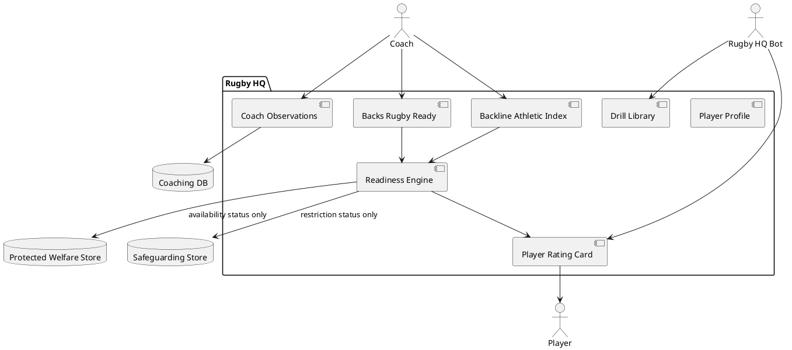
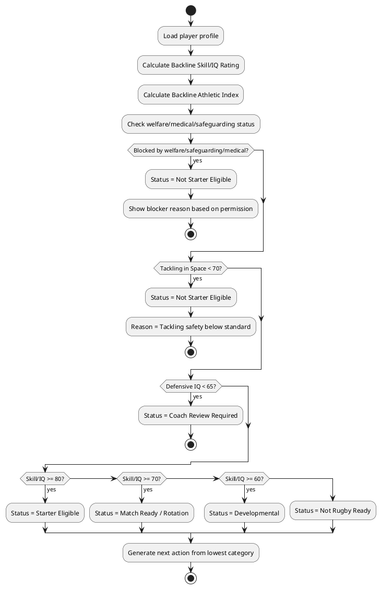

# SPEC-7-Rugby-HQ-Backs-Readiness

## Background

Pocket PT Rugby Coaching OS has a strong foundation for rugby operations and forward readiness. The current gap is backs readiness. Forwards are supported by scrum/contact progression, but backs need an equivalent framework for judging players from 10 to 15.

Rugby HQ should add a Backs Rugby Ready module and a separate Backline Athletic Index so players understand exactly what makes them eligible for the starting lineup.

## Requirements

### Must Have

- A visible 1–99 Backline Skill/IQ Rating.
- A separate 1–99 Backline Athletic Index.
- Defensive IQ scoring for backs.
- Tackling-in-space scoring with a hard starter-eligibility gate.
- Offensive with-ball scoring.
- Offensive off-ball scoring.
- Role-specific overlays for 10, 12, 13, wing, and 15.
- Coach observation records with notes, evidence type, evaluator, date, confidence, and next action.
- Player-facing readiness status: starter eligible, match-ready, developmental, or blocked.
- Hard gates for safety, welfare, medical, safeguarding, and role-specific restrictions.
- Clear next-action recommendations for low scores.

### Should Have

- Video clip/timestamp attachment for evaluations.
- Scrimmage and match evidence weighting.
- Drill library tied to each competency.
- Trend history over time.
- Coach disagreement / second-review workflow for major selection decisions.
- Position recommendation engine based on score profile.

### Could Have

- Player self-reflection after coach evaluation.
- Guardian-facing summary for youth players.
- Team comparison charts.
- AI-generated improvement plans from rubric gaps.
- Integration with wearable/GPS data.
- Integration with video-analysis platforms.

### Won't Have in MVP

- Official governing-body certification replacement.
- Medical diagnosis.
- Safeguarding investigation decisions.
- Fully automated lineup selection without coach approval.

## Method

### Architecture



### Core scoring model

```text
Backline Skill/IQ Rating =
  Defensive IQ * 0.20 +
  Tackling in Space * 0.15 +
  Attack IQ * 0.20 +
  Ball Skills * 0.15 +
  Movement & Evasion * 0.15 +
  Role-Specific Skill * 0.15
```

### Backline Athletic Index

```text
Backline Athletic Index =
  Speed * 0.25 +
  Agility * 0.25 +
  Repeat Effort * 0.20 +
  Endurance * 0.15 +
  Power * 0.10 +
  Strength * 0.05
```

### Starter eligibility algorithm



### Suggested database tables

#### players

```sql
CREATE TABLE players (
  id TEXT PRIMARY KEY,
  first_name TEXT NOT NULL,
  last_name TEXT NOT NULL,
  preferred_name TEXT,
  primary_position TEXT,
  secondary_positions TEXT,
  active BOOLEAN NOT NULL DEFAULT TRUE,
  created_at TEXT NOT NULL,
  updated_at TEXT NOT NULL
);
```

#### backline_evaluations

```sql
CREATE TABLE backline_evaluations (
  id TEXT PRIMARY KEY,
  player_id TEXT NOT NULL REFERENCES players(id),
  position_evaluated TEXT NOT NULL,
  category TEXT NOT NULL,
  competency TEXT NOT NULL,
  score INTEGER NOT NULL CHECK (score >= 1 AND score <= 99),
  evidence_type TEXT NOT NULL,
  coach_note TEXT,
  next_action TEXT,
  clip_url TEXT,
  clip_timestamp TEXT,
  evaluator_id TEXT,
  confidence TEXT NOT NULL DEFAULT 'medium',
  evaluated_at TEXT NOT NULL,
  created_at TEXT NOT NULL
);
```

#### athletic_tests

```sql
CREATE TABLE athletic_tests (
  id TEXT PRIMARY KEY,
  player_id TEXT NOT NULL REFERENCES players(id),
  test_name TEXT NOT NULL,
  category TEXT NOT NULL,
  result_value REAL NOT NULL,
  result_unit TEXT NOT NULL,
  protocol TEXT,
  score INTEGER CHECK (score >= 1 AND score <= 99),
  tested_at TEXT NOT NULL,
  evaluator_id TEXT,
  created_at TEXT NOT NULL
);
```

#### readiness_snapshots

```sql
CREATE TABLE readiness_snapshots (
  id TEXT PRIMARY KEY,
  player_id TEXT NOT NULL REFERENCES players(id),
  position_evaluated TEXT NOT NULL,
  skill_iq_rating INTEGER NOT NULL,
  athletic_index INTEGER,
  safety_status TEXT NOT NULL,
  readiness_status TEXT NOT NULL,
  blocker_reason TEXT,
  next_action TEXT,
  calculated_at TEXT NOT NULL
);
```

#### audit_log

```sql
CREATE TABLE audit_log (
  id TEXT PRIMARY KEY,
  actor_id TEXT NOT NULL,
  action TEXT NOT NULL,
  entity_type TEXT NOT NULL,
  entity_id TEXT NOT NULL,
  before_json TEXT,
  after_json TEXT,
  created_at TEXT NOT NULL
);
```

### Bot behavior

The bot should use these resources to:

- explain why a player has a rating,
- generate player development plans,
- recommend drills for weak competencies,
- summarize coach observations,
- prepare reassessment checklists,
- support but not replace coach selection decisions.

The bot must not:

- diagnose medical issues,
- reveal restricted safeguarding narratives,
- override welfare restrictions,
- label a player as certified by USA Rugby or World Rugby unless that credential is independently verified.

## Implementation

1. Add Rugby HQ resource files to repo.
2. Build rubric JSON loader.
3. Add database tables or local-first storage equivalent.
4. Add coach evaluation form.
5. Add player rating card.
6. Add readiness calculation service.
7. Add role-specific overlays.
8. Add athletic test form.
9. Add audit logging.
10. Add bot context loader pointed at `resources/rugby-hq`.

## Milestones

1. Resource ingestion complete.
2. Coach can create a backline evaluation.
3. Player can view Backline Skill/IQ Rating.
4. Hard gates affect starter eligibility.
5. Athletic Index appears separately.
6. Role-specific overlays display correctly.
7. Bot can explain ratings and recommend next actions.
8. Production permissions and audit logs are added.

## Gathering Results

Measure success by:

- coaches can explain selection decisions more clearly,
- players understand what to improve,
- backline defensive errors decrease,
- unsafe tackling is identified before matches,
- player ratings improve over time with evidence,
- selection disputes decrease because criteria are visible,
- no restricted welfare/safeguarding data leaks into general coaching views.

## Need Professional Help in Developing Your Architecture?

Please contact me at [sammuti.com](https://sammuti.com) :)
